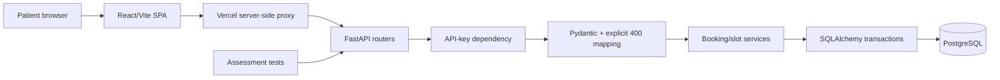

# System architecture

## Style: modular monolith

One FastAPI deployment with separate modules for routing, authentication, validation, services, persistence, and rate limiting. A React SPA provides patient UX. A Vercel server-side proxy can forward frontend requests with a private API key; external evaluator calls go directly to FastAPI. Supabase is used as managed PostgreSQL, not as a second business-logic API.



## Responsibilities

- **API routes:** URL/method matching, request/response serialization and status codes.
- **Authentication dependency:** constant-time comparison of configured key; common 401 error shape.
- **Validation:** trim and normalize fields, reject malformed input with specified 400 rather than FastAPI's default 422 when required.
- **Booking service:** booking/cancellation rules, status transitions and idempotency decisions.
- **Persistence:** atomic transactions, database constraints, stable ordering and pagination.
- **Rate limiting:** durable or shared per-email attempt counters, accurate Retry-After; do not rely on per-process memory.
- **Frontend:** slot list, provider filter, booking form, success/error states, accessible confirmation.

## Main booking flow

```mermaid
sequenceDiagram
  participant C as Client
  participant A as FastAPI
  participant D as PostgreSQL
  C->>A: POST /bookings + X-API-Key
  A->>A: Authenticate; parse and normalize
  A->>D: Reserve rate-limit attempt (shared state)
  A->>D: Transaction: check idempotency and slot
  D-->>A: Insert confirmed booking or constraint conflict
  A-->>C: 201 booking / 400 / 404 / 409 / 422 / 429
```

## Concurrency

Use a PostgreSQL partial unique index on `bookings(slot_id)` for rows whose `status = 'confirmed'`. The index is the final invariant even if two workers both see a slot as available. Catch the database conflict and translate to 409. Cancellation changes status in a transaction and frees the unique-index entry.

## Idempotency

A durable unique key plus request fingerprint and stored response metadata avoids duplicates. Acquire serialization per key (unique insertion/locking); never do an unprotected check-then-insert. Specify precedence with rate limiting and replay of failures before implementation.

## Pagination

Use `(created_at, id)` as stable ascending order; encode cursor as opaque token and filter by normalized email. Query one extra row to determine `next_cursor`. Reject malformed cursors consistently (behavior beyond limit validation should be confirmed).

## Deployment constraints

Render free instances may sleep; database connection pooling and cold starts need testing. Verify current provider quotas and availability before deployment. Keep secrets server-side. After submission, freeze the deployed revision until contacted.
