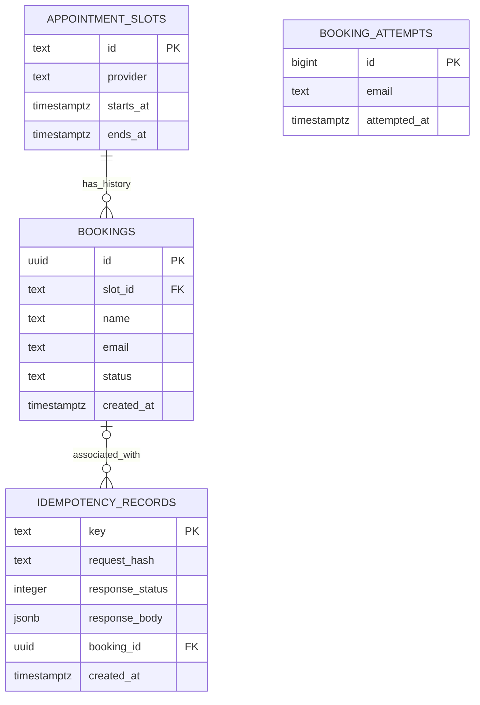

# Entity relationship diagram (ERD)

Conceptual PostgreSQL schema; migration definitions will be finalized during implementation.

`BOOKING_ATTEMPTS` is logically grouped by normalized email, but no patient account table exists in the assessment contract. It therefore has no foreign-key relationship to bookings. `IDEMPOTENCY_RECORDS.booking_id` may be nullable because some replayed responses can be errors, depending on the finalized idempotency design.

## Key integrity rules

1. `appointment_slots.id` is unique and caller-provided.
2. `bookings.slot_id` references a valid slot.
3. `bookings.status` is either `confirmed` or `cancelled`.
4. A partial unique index guarantees at most one `confirmed` booking per `slot_id`.
5. Cancelled bookings remain in history until `/reset`.
6. `/reset` replaces all slots and removes bookings in one transaction.
7. Booking-history cursor ordering uses `(created_at, id)`.

See [database design](DATABASE_DESIGN.md) for indexes and transactional requirements.
