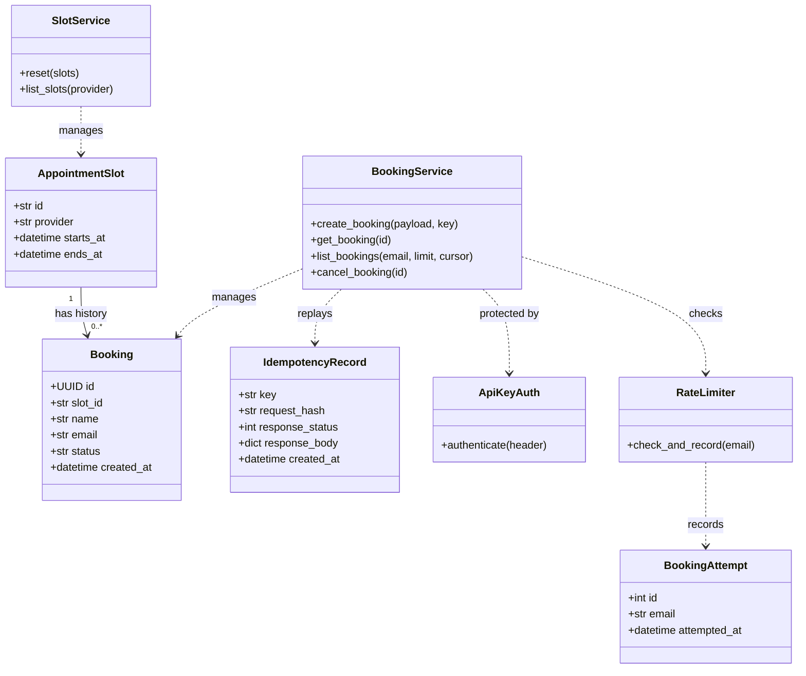
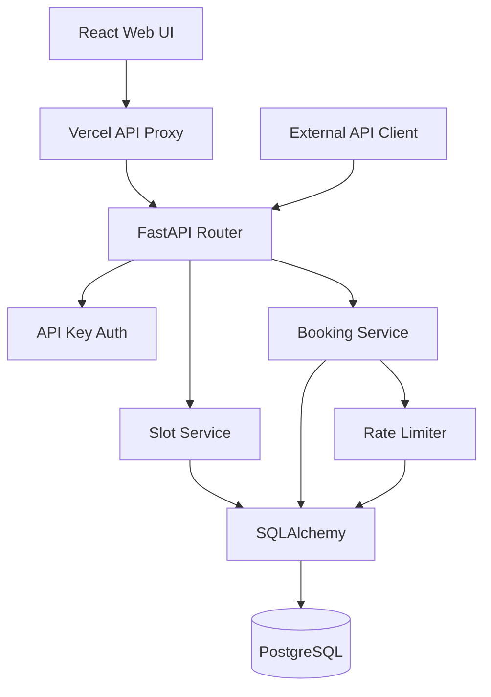
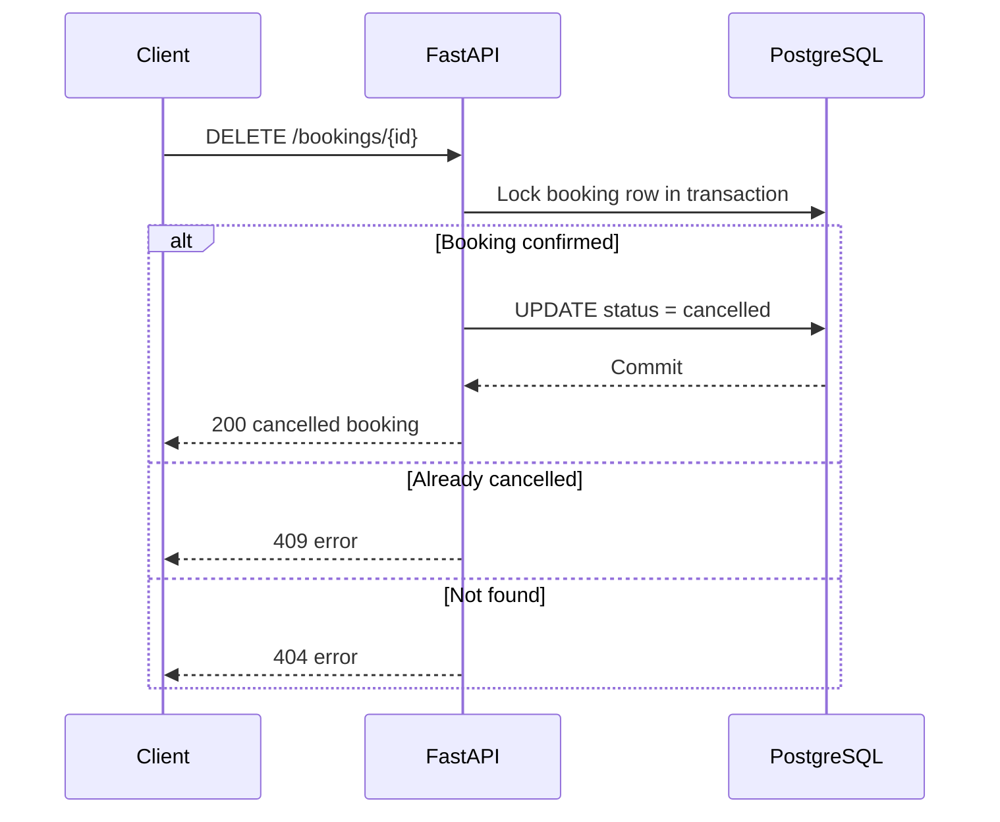

# UML diagrams

These are conceptual designs, not claims about classes already implemented. GitHub renders Mermaid diagrams.

## UML class diagram



## Component diagram



## Sequence: two patients book same slot

```mermaid
sequenceDiagram
  participant A as Patient A
  participant B as Patient B
  participant API as FastAPI
  participant DB as PostgreSQL
  par Request A
    A->>API: POST /bookings (slot s1)
    API->>DB: INSERT confirmed booking
  and Request B
    B->>API: POST /bookings (slot s1)
    API->>DB: INSERT confirmed booking
  end
  DB-->>API: One insert commits; one unique conflict
  API-->>A: 201 if A won, otherwise 409
  API-->>B: 201 if B won, otherwise 409
```

## Sequence: cancellation


